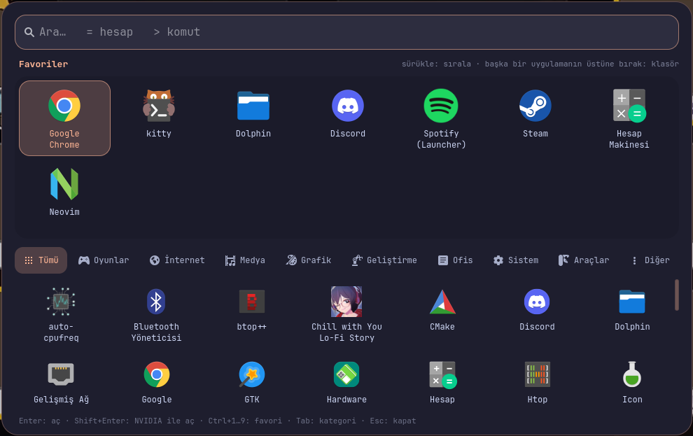

# Başlatıcı

GTK4 + libadwaita ile yazılmış, Türkçe uygulama başlatıcı. Favoriler, sürükle-bırak ile sıralama,
klasörler, kategoriler, arama, hesap ve komut çalıştırma bir arada.



## Özellikler

- **Favoriler:** sürükle-bırak ile sırala; bir uygulamayı diğerinin **üstüne** bırakınca klasör oluşur
- **Klasörler:** klasörü aç, adını tıklayıp değiştir, içinde sırala; uygulamayı "Favoriler" düğmesine
  bırakınca klasörden çıkar, tek uygulama kalınca klasör kendiliğinden dağılır
- **Tüm uygulamalar:** kategori sekmeleri (Oyunlar, İnternet, Medya, Geliştirme...); buradan favorilere
  sürükleyebilir, favoriyi buraya sürükleyerek favorilerden çıkarabilirsin
- **Arama:** Türkçe karakter duyarsız (`kıtty` → kitty, `dosya` → Dolphin), bulanık eşleşme
- **Sık kullanılanlar önce:** en çok ve en son açtıkların listede ve aramada üstte
- **Hesap:** `=240*15%` (ya da sadece `2+2`) yaz, sonuç anında; Enter panoya kopyalar
- **Komut:** `>btop` yaz, Enter arka planda çalıştırır, Ctrl+Enter terminalde
- **NVIDIA ile aç:** sağ tık menüsü ya da Shift+Enter (hibrit GPU'lu laptoplarda PRIME render offload)
- **Anında açılır:** arka planda hazır bekler, kısayola basınca ~0,2 sn'de görünür
- **Pencerelerin üstünde:** gtk4-layer-shell ile tam ekran uygulamaların da üstünde açılır
- **Canlı accent rengi:** `~/.config/accent/colors.css` değişince renk anında güncellenir

## İndir ve kur

```bash
git clone https://github.com/nazms23/baslatici.git ~/Projects/baslatici
cd ~/Projects/baslatici
./install.sh
```

Veya [son sürümü indir](https://github.com/nazms23/baslatici/releases/latest) (zip/tar.gz), aç ve `./install.sh` çalıştır.

Kurulum, repo klasörüne symlink verir: klasörü silme/taşıma. Güncellemek için `git pull` yeterli.

**Bağımlılıklar:** Python 3, GTK4, libadwaita, gtk4-layer-shell ve Python bağları. Eksikse `install.sh` söyler:

| Dağıtım | Komut |
|---|---|
| Arch | `sudo pacman -S --needed python-gobject gtk4 libadwaita gtk4-layer-shell` |
| Debian/Ubuntu | `sudo apt install python3-gi gir1.2-gtk-4.0 gir1.2-adw-1 gir1.2-gtk4layershell-1.0` |
| Fedora | `sudo dnf install python3-gobject gtk4 libadwaita gtk4-layer-shell` |

**Kaldırma:** `./install.sh --uninstall` (favori düzeni korunur: `~/.config/baslatici/duzen.json`)

## Hyprland ayarı (Lua config)

```lua
-- Oturum acilinca arka planda hazir beklesin
hl.on("hyprland.start", function()
    hl.exec_cmd("~/.local/bin/baslatici --daemon")
end)

-- Ac / kapa
hl.bind("SUPER + R", hl.dsp.exec_cmd("~/.local/bin/baslatici"))

-- Panel buzlu cam olsun, arka plandaki karartma blur'lanmasin
hl.layer_rule({ match = { namespace = "^baslatici$" }, blur = true, ignore_alpha = 0.5 })
```

Komutlar: `baslatici` (aç/kapa), `baslatici --daemon` (arka planda başlat), `baslatici --hide`, `baslatici --quit`.

## Klavye

| Tuş | İşlem |
|---|---|
| Yazmak | Ara (`=` hesap, `>` komut) |
| Oklar | Seç |
| `Enter` | Aç / klasöre gir / sonucu kopyala / komutu çalıştır |
| `Shift+Enter` | NVIDIA ile aç |
| `Ctrl+Enter` | Komutu terminalde çalıştır |
| `Ctrl+1…9` | N'inci favoriyi aç |
| `Tab` / `Shift+Tab` | Kategori değiştir |
| `Ctrl+C` | Hesap sonucunu kopyala |
| `Esc` | Aramayı temizle → klasörden çık → kapat |
| Sağ tık | Aç, NVIDIA ile aç, favorilere ekle/çıkar, klasörden çıkar, klasörü dağıt |

## Dosyalar

| Dosya | İçerik |
|---|---|
| `~/.config/baslatici/duzen.json` | Favoriler ve klasörler (elle de düzenlenebilir) |
| `~/.local/share/baslatici/kullanim.json` | Son açılışlar (sık kullanılanlar sıralaması) |
| `~/.config/accent/colors.css` | (isteğe bağlı) accent rengi, libadwaita `--accent-*-color` değişkenleri |

Terminal uygulamaları için varsayılan terminal `kitty`; değiştirmek için `BASLATICI_TERMINAL` ortam değişkeni.

## Lisans

[GPL-3.0-or-later](LICENSE). Kullanabilir, değiştirebilir ve dağıtabilirsin; değiştirilmiş sürümü dağıtırsan
kaynak kodunu da aynı lisansla paylaşman gerekir.
